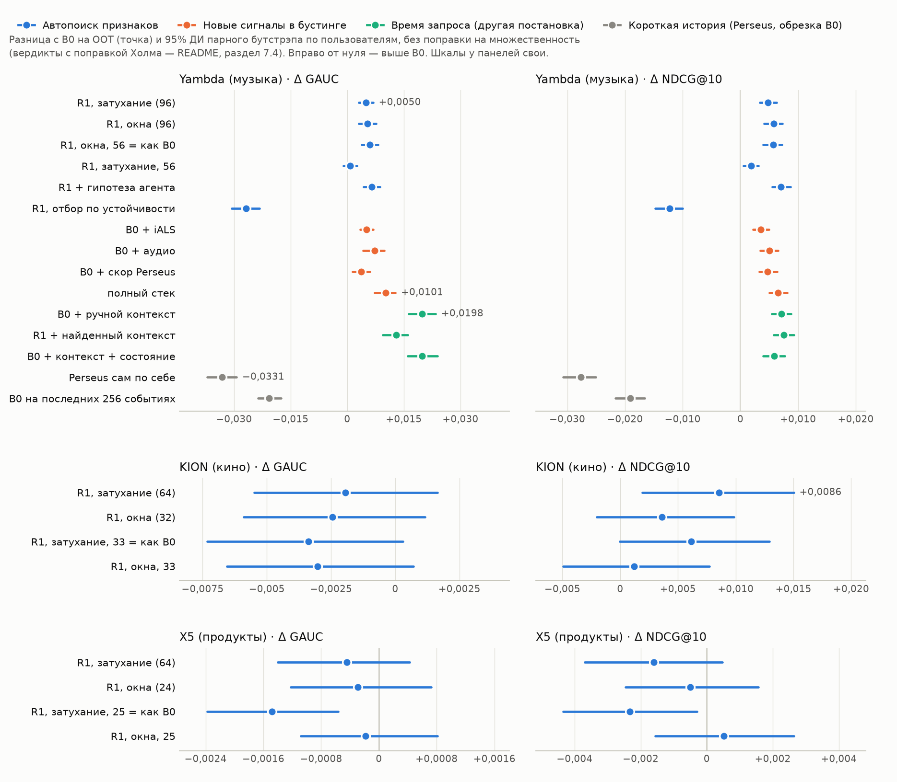

# Можно ли не придумывать признаки руками?

Тестовое задание Т-Банка. Сравниваем сильный бустинг на ручных признаках с автоматическим построением признаков (поиск по грамматике агрегатов, LLM-агент) и с обучаемыми представлениями (Perseus) на трёх доменах: музыка (Yambda), кино (KION), продукты (X5).

> **Статус.** Пайплайн заморожен (опубликованный эквивалент исторического коммита `db1a3920ea3d897566541b9966bf995bec45ce9f`, манифест с хэшами в `artifacts/*/freeze.json`), OOT прогнан один раз. Ниже — val-B (чистая половина val, на ней ничего не подбиралось) и OOT.

## 0. Коротко

**Ответ на вопрос задания: агрегаты истории можно отдать машине.** Автоматический поиск по грамматике агрегатов в музыке оказался лучше сильного бустинга на ручных признаках. В кино и продуктах значимой разницы нет, а в кино поиск лучше по качеству верха списка (NDCG@10). Строго доказать «не хуже» для кино и продуктов данные не позволяют: нижние границы ДИ доходят до −0,0055 GAUC при пороге 0,002. Руками стоит искать другое: новые источники сигнала. Время запроса даёт вчетверо больше автопоиска, текущая сессия — в 20 раз больше.

| GAUC внутри пользователь-дня на OOT, 95% ДИ, вердикт с поправкой Холма | Yambda (музыка) | KION (кино) | X5 (продукты) |
|---|---|---|---|
| ручной бустинг B0 | 0,5842 | 0,7840 | 0,8213 |
| автопоиск R1 против B0, GAUC | **+0,0050 [+0,0030; +0,0069], лучше**, 7 из 7 дней | −0,0019 [−0,0055; +0,0016], сопоставимо | −0,0004 [−0,0014; +0,0004], сопоставимо |
| то же, NDCG@10 | +0,0048, лучше | **+0,0086 [+0,0019; +0,0150], лучше** | −0,0016, сопоставимо |



*Рисунок 1. Разница с B0 на OOT и 95% ДИ по исследовательским веткам трёх доменов (`scripts/figures.py`, данные — `artifacts/*/compare_oot_eval.json`). Интервалы без поправки на множественность; вердикты с поправкой Холма — в разделе 7.4. Простые правила — в таблицах раздела 7.*

**Масштаб.** Внутри пользователь-дня разности малы по природе задачи. Случайный порядок даёт 0,50, а метка шумная: когда лента ставит человеку один трек дважды за день, исход совпадает в 69% случаев при 51% у случайного совпадения (`artifacts/label_checks.json`). Поэтому для масштаба удобна условная линейка — насколько ручной B0 лучше лучшего простого правила («доля Listen+ трека»): на 0,042 GAUC. Это единица измерения, а не доля заменённой ручной работы. В этих единицах (Yambda, OOT):

| Что добавлено к B0 | Δ GAUC | Доля от вклада ручных признаков |
|---|---|---|
| автопоиск R1, без участия человека | +0,0050 | 12% |
| R1 + принятая гипотеза LLM-агента | +0,0065 | 15% |
| полный стек: R1 + iALS + аудио + скор Perseus | +0,0101 | 24% |
| время запроса, ручной контекст | +0,0198 | 47% |
| текущая сессия (опорная точка, только val-B) | +0,0939 | ≈ 200% (на val-B вклад ручных признаков — 0,048) |

В продуктовых единицах: доля дослушанных треков в первых 10 позициях — 68,5% при случайном порядке, 71,6% у B0, 71,8% у R1, 72,0% у полного стека (`artifacts/guardrails_oot_eval.md`).

**Что ещё показал эксперимент:**
- **«Почему 7 дней, а не 10» — не главный вопрос.** При равном числе признаков поиск по сетке затухания проиграл поиску по жёстким окнам: −0,0053 в Yambda, −0,0013 в X5, в KION сопоставимо. Наборы отбирались отдельно, поэтому сравниваются две процедуры поиска, а не форма веса в чистом виде. Подбор периода затухания преимущества не дал.
- **Perseus (фреймворк Т-Банка)** сам по себе хуже B0 на 0,033, как признак бустинга даёт +0,0037. Так же вышло у трансформера в индустриальной работе ARGUS. Правдоподобная главная причина — короткая история: если обрезать историю пользователя в B0 до тех же последних 256 событий, B0 теряет 0,021 (почти две трети разрыва). Это наблюдение, а не разложение причин.
- **Отрыв автопоиска растёт с данными.** На 10% пользователей R1 и B0 равны, на всех R1 впереди, а B0 почти перестаёт расти уже на трети. Это одна подвыборка и три точки без оценки разброса — наблюдение, а не закономерность (раздел 9).
- **Метод переносится без ручных правок:** меняется только описание схемы. Поиск сам переключается с прямых связей (музыка, продукты) на косвенные и демографию (кино).
- **LLM-агент поверх перебора почти бесполезен:** из 30 гипотез принята 1, к R1 она добавляет около +0,0015.
- **Не сработало** (разбор в разделе 8): отбор признаков по устойчивости во времени (−0,027); контекст, найденный поиском, против ручного (−0,0069); признаки «состояния слушателя» поверх контекста (±0).
- **Цена R1:** около 52 минут на 5 потоках на поиск и сборку признаков, обучение на 50% дольше B0, инференс меньше 0,1 с на 1 тыс. строк. Затухающие счётчики потоковые.

**Что бы я внедрил** (подробнее — раздел 10): автопоиск вместо ручной сборки агрегатов; поверх — время запроса и аудио; Perseus — как признак бустинга, а не отдельный ранжировщик. Следующий шаг — сессионные признаки в потоке.

**Почему этим числам можно верить:**
- одно разбиение, одни кандидаты и один бюджет настройки бустинга для всех веток; весь подбор — на val;
- OOT прогнан один раз, за воротами с хэшами: заморозка — опубликованный эквивалент исторического коммита `db1a3920ea3d897566541b9966bf995bec45ce9f` и `artifacts/freeze.json`, результаты — следующими коммитами;
- парный бутстрэп по пользователям, поправка Холма;
- тесты инвариантности к обрезке лога для каждого семейства признаков; весь поиск R1 на метках, перемешанных внутри пользователь-дня, даёт GAUC 0,500–0,507;
- модели первого уровня обучены строго до своих меток;
- слепое ревью кода до заморозки (Codex, только чтение).

## 1. Постановка

**Продуктовая рамка.** Рекомендательная лента Яндекс Музыки («Моя волна» и персональные плейлисты): трек ставит сервис, человек дослушивает его или пропускает. Это прямой аналог «показ → клик» из условия.

**Задача А (основная, Yambda).**
- **Строка** — алгоритмический показ (`is_organic = 0`) пользователя в день d.
- **Метка** — Listen+: прослушано ≥ 50% трека, как в статье Yambda.
- **Задача модели** — ранжировать показы пользователя внутри дня.
- **Кандидаты** одинаковы для всех методов: залогированные показы. Поэтому сравнивается представление (признаки, модели), а не генерация кандидатов.

**Перенос (KION, X5).**
- Строка — пара (пользователь, кандидат) на целевую неделю.
- Метка — просмотр (KION) или покупка (X5) кандидата за неделю.
- Кандидаты строятся одинаково для всех методов, по истории до начала недели:
  - KION — популярное за 7 дней и iALS, без уже просмотренного;
  - X5 — частые прошлые покупки, популярное и iALS.

**Почему не next-item по всему каталогу.** Тогда результат определял бы генератор кандидатов, а не признаки. Числа в таблицах статьи Yambda получены для другой задачи и с нашими не сравниваются.

## 2. Данные

| | Yambda-50M | KION | X5 RetailHero |
|---|---|---|---|
| Домен | музыка (Яндекс) | фильмы и сериалы (МТС) | продуктовый ритейл |
| Выборка | 10 тыс. пользователей с полной историей (весь 50M), из них 9 238 с прослушиваниями | 30 тыс. пользователей, вся история | 10 тыс. клиентов, вся история |
| События | 47,8 млн: прослушивания (`played_ratio`, органика), лайки, дизлайки, их отмены | 169 тыс. просмотров (доля и длительность) | 1,16 млн строк чеков |
| Время | секунды, округление до 5 с, 301 день; суточный и недельный циклы относительные | даты, 163 дня | дата и время, 118 дней |
| Атрибуты | артист, альбом, длина, аудио-эмбеддинги 128-d | жанры, страны, режиссёры, актёры, студии (по несколько значений), тип, год, рейтинг; пол, возраст, доход, дети | 4 уровня категорий, сегмент, бренд, СТМ, алкоголь; возраст, пол (всё — хэши) |
| Строк задачи | 2,85 млн (дни 273–300) | 1,41 млн (5 недель) | 2,78 млн (5 недель) |
| Положительных | ≈ 69% (Listen+) | 1,1% | 5% |

**Yambda, о чём стоит помнить:**
- 59% алгоритмических показов — треки, которые пользователь уже слушал;
- рекомендательные события по карточке датасета — это персональная лента и персональные плейлисты;
- карточка не говорит, что значит время события: начало, конец или запись в лог.

Подробная опись признаков и полей — `docs/data_inventory_RU.md`.

## 3. Разбиение и защита от утечек

| | Yambda (дни) | KION / X5 (целевые недели) |
|---|---|---|
| Обучающие строки, этап val | 273–286 | c1, c2, c3 |
| val (A — подбор, B — проверка) | 287–293 | c4 |
| OOT (один прогон) | 294–300 | c5 = последние 7 дней |
| Обучение перед OOT (сдвиг на 7 дней) | 280–293 | c2, c3, c4 |

**Снимок на начало дня.** Признаки строки дня d считаются только по событиям с `t < начало дня d`. События самого дня в признаки не попадают: ни метка строки, ни другие показы, ни их порядок. Исключения сделаны только в отдельно помеченных ветках:
- время запроса (раздел 6.5);
- сегодняшняя сессия (раздел 6.7).

**Подбор и проверка:**
- val делится пополам по пользователям, фиксированным хэшем;
- на половине A — отбор признаков, Optuna, ранняя остановка, гипотезы агента;
- половина B — только для отчёта.

**Модели первого уровня, чьи скоры идут в бустинг.**
- Yambda: iALS и Perseus (R4) обучаются на событиях до первого обучающего дня бустинга, отдельно для каждого этапа: для val iALS — до дня 273, Perseus — на метках дней 259–272; для OOT — до дня 280 и на метках 266–279. Вектор пользователя в iALS пересчитывается по истории до начала дня строки, факторы треков фиксированы.
- KION и X5: генератор кандидатов (популярное, iALS) переобучается перед каждой целевой неделей c только на событиях до c. Метка строки лежит в [c, c+7), поэтому модель своей метки не видит. Правило «скользящее», то же, что для признаков.

**Кто попадает в строки KION и X5.** Пользователи, у которых есть история и хотя бы одно действие в целевой неделе. Это стандартный протокол KION: ранжируем для тех, кто пришёл. Отбор одинаков для всех методов, в признаки сам факт прихода не входит.

**Проверки:**
- **инвариантность к обрезке** (`tests/test_no_leakage.py`, `tests/test_generic.py`): признаки на полном логе совпадают с признаками на логе, обрезанном по отсечке, и не меняются при перемешивании всех событий с дня строки. Покрыты B0, B0 на обрезанной истории, вся грамматика обеих сеток (1 127 + 1 295 признаков), признаки агента, аудио, контекст запроса, состояние слушателя и сессионные признаки;
- **признак не зависит от собственной метки строки**;
- **плацебо:** весь поиск R1 на метках, перемешанных внутри пользователь-дня, даёт GAUC 0,500–0,507 при любом K;
- **ворота OOT** (`src/tbrec/freeze.py`):
  - `freeze.json` хранит коммит, ветки, гипотезы, пороги и sha256 всего, от чего зависит скор: строк, выбранной цели, `params.json` каждой ветки и каждого файла признаков;
  - перед каждым скорингом OOT — бустинг, простое правило или Perseus (`scripts/score_r3_oot.py`) — проверяется, что ветка в списке, код не изменён, хэши совпадают и предсказания OOT ещё нет;
  - флага для повторного прогона нет;
- **слепое ревью кода** (LLM, только чтение, `docs/reproducibility_RU.md`) перед заморозкой нашло слабые ворота OOT, ничьи в NDCG, сужение семейства Холма, неточное «равное число признаков» и недетерминированность кандидатов X5. Всё исправлено, добавлены тесты `tests/test_protocol.py`. Остальные находки и почему это не утечки — раздел 11.

## 4. Метрики и правило решений

- **Основные метрики:**
  - GAUC — AUC внутри пользователь-дня (или пользователь-недели), взвешенный по числу строк;
  - NDCG@10 внутри той же группы;
  - группы, где все метки одинаковые, выпадают.
- **Вторичные:** общий ROC-AUC и LogLoss. Общий ROC-AUC в основном различает пользователей между собой, ранжирование внутри группы он почти не видит.
- **Статистика:** парный бутстрэп по пользователям, 1000 повторов; пользователь берётся со всеми своими днями. Для каждого дня отдельно считается, выиграла ли ветка.
- **Решающие слова** (`src/tbrec/metrics.py`, зафиксированы до OOT):
  - «лучше» — нижняя граница 95% ДИ разности > 0;
  - «хуже» — верхняя граница < 0;
  - «сопоставимо» — ДИ содержит 0 и |Δ| < 0,002 GAUC или 0,003 NDCG@10;
  - иначе — «не определено».
  - Порог 0,002 — практическая граница, выбранная до OOT: на val-B две версии R1, отличающиеся одним признаком (56 и 57), расходятся на 0,0016–0,0017 (`artifacts/runs/r1_*_k56`, `artifacts/runs/r1_*_k57_offbyone`). Разница меньше 0,002 сравнима с эффектом одного признака. Разброс повторной настройки одной и той же конфигурации отдельно не измерялся.
- **Несколько гипотез:** поправка Холма (`scripts/hypotheses.py`).
- **Равный бюджет подбора:**
  - 12 испытаний Optuna на 30% пользователей обучающего окна;
  - ранняя остановка по GAUC на val-A;
  - цель LightGBM выбирается один раз на B0 по val-A и фиксируется: Yambda и X5 — binary, KION — lambdarank.
  - LogLoss для ранней остановки не подошёл: он реагирует на сдвиг общей доли Listen+ между неделями и останавливал обучение слишком рано.

## 5. Бейзлайн B0: LightGBM на ручных признаках

Окна 1, 7, 30 дней и вся история (`src/tbrec/specs.py`, `kion.py`, `x5.py`). Набор такой, какой написал бы инженер:
- **пользователь:** активность, доли Listen+, пропусков и органики, лайки, разнообразие, давность;
- **объект:** популярность, доля дослушиваний, лайки и дизлайки;
- **прямые связи пары** (Yambda, X5): сколько раз слушал или покупал, доля дослушиваний, давность;
- **косвенные связи:** пользователь × артист, альбом, жанр, актёр, режиссёр, категория, бренд;
- **демография × объект** (KION, X5).

Базовый блок, общий для всех веток: длина трека, возраст объекта в логе, стаж пользователя, ритм прослушивания; для KION и X5 — ранги генераторов кандидатов и статические атрибуты.

## 6. Исследовательские ветки

### 6.1. R1 — автоматический поиск по грамматике агрегатов

Признак — имя `КЛЮЧ__ФИЛЬТР__АГРЕГАТ__ВЕС`, например `UA__lp__rate__h7d`: «доля прослушиваний этого артиста пользователем, дошедших до Listen+, с периодом полураспада 7 дней».
- **ключи** — сущности и их пары: пользователь, объект, атрибуты объекта, пользователь × атрибут, атрибут пользователя × объект;
- **фильтры** — тип события и порог глубины;
- **агрегаты:** счётчик, сглаженная доля, средняя глубина, давность последнего, возраст первого, число уникальных;
- **вес:** вся история, жёсткое окно `w<n>` или экспоненциальное затухание `h<n>` с периодом полураспада от 6 часов до 365 дней.

Граница ручной работы: человек задаёт схему данных (какие сущности, атрибуты и типы событий есть) и общий словарь агрегатов и сроков; какие комбинации и сроки взять, решает поиск. Для KION и X5 вручную писалось только описание схемы. Датасет описывается схемой (`src/tbrec/generic.py`). Атрибуты с несколькими значениями (жанры, актёры) раскладываются по значениям и усредняются. Тест проверяет, что движок по схеме в точности воспроизводит движок Yambda.

**Поиск:**
1. Все кандидаты (Yambda — 1 127 в сетке затухания и 1 295 в сетке окон) считаются на подвыборке отбора.
2. Важности берутся из модели lambdarank (группа — пользователь-день). При бинарной цели gain уходит в признаки пользователя, а их GAUC внутри группы не видит.
3. Кривая top-K на val-A; берётся наименьший K в пределах 0,0005 от лучшего.

Затухающие счётчики потоковые: O(1) на событие, два состояния складываются умножением и сложением.

### 6.2. R2 — скоры моделей и содержание как признаки
- **iALS:** факторы объектов до отсечки, вектор пользователя пересчитывается ежедневно.
- **Аудио:** профиль вкуса — сумма эмбеддингов дослушанных треков с затуханием 30 дней, отдельно профиль пропущенных; признак — косинус трека к профилю.

### 6.3. R3/R4 — Perseus (фреймворк Т-Банка)
- Голова ранжирования по кандидатам; история — прослушивания с долей и органикой, лайки, дизлайки, артист, альбом; история строго до начала дня.
- Конфигурация выбрана на val-A среди трёх вариантов. Победил облегчённый: 256 событий, размер 128, 2 слоя. Конфиг авторов (512 событий, размер 256, 4 слоя) тоже проверен и чуть хуже.
- R4 — скор Perseus как признак бустинга. Perseus для этого обучен до первого обучающего дня бустинга: на метках дней 259–272 для val и 266–279 для OOT.
- Раздельные лимиты истории по типам событий (H6) эффекта не дали: 0,5519 против 0,5520.

### 6.4. R5 — LLM-агент, генерирующий гипотезы
- LLM (только чтение, без доступа к данным) видит грамматику, текущий набор с важностями и журнал прошлых раундов и предлагает 10 признаков. Это имена грамматики или составные `ratio(a,b)` и `diff(a,b)`.
- Каждое предложение проходит тест инвариантности и детерминированную оценку прироста на val-A (порог +0,001).
- 3 раунда, журнал — `artifacts/r5_state.json`.

### 6.5. Время запроса (контекст)
- Час, часть суток и день недели самого показа плюс история пользователя, трека и артиста в это время. Например, «доля Listen+ этого человека в эту четверть суток».
- Это меняет постановку с «набора на начало дня» на «ранжирование в момент запроса», поэтому ветки сравниваются парой: ручной контекст против найденного поиском.

### 6.6. Состояние слушателя
- Эмоций в логе нет, их заменяет звучание × время: близость трека к тому, что человек дослушивает в эту часть суток; вчерашний профиль против привычного; 32 кластера звучания как «настроения без названий» в грамматике.
- Кластеризация использует только содержание треков, без меток.

### 6.7. Потоковое расширение (сессия)
- Опорная точка, не участник основного сравнения.
- Признаки — исходы сегодняшних прослушиваний пользователя строго раньше показа: события из того же 5-секундного интервала исключены, промежутки по времени не используются (если метка — конец прослушивания, промежуток выдал бы длину текущего).

## 7. Результаты

Сводный рисунок по всем веткам — в разделе 0. Полные таблицы с ДИ по NDCG@10 и ROC-AUC: `artifacts/final_val_B.md`, `artifacts/compare_oot_eval.md`, для KION и X5 — те же файлы в `artifacts/kion/` и `artifacts/x5/`.

### 7.1. Yambda (база B0: val-B 0,5872 / OOT 0,5842 GAUC; NDCG@10 0,7635 / 0,7656)

| Ветка | Δ GAUC, val-B | Δ GAUC, OOT [95% ДИ] | Δ NDCG@10, OOT | Дней OOT с Δ>0 |
|---|---|---|---|---|
| доля Listen+ трека (правило) | −0,0477 | −0,0421 | −0,0337 | 0/7 |
| «сначала то, что слушал» | −0,0511 | −0,0463 | −0,0195 | 0/7 |
| **R1, затухание (96)** | +0,0047 | **+0,0050 [+0,0030; +0,0069]** | +0,0048 | 7/7 |
| R1, окна (96) | +0,0046 | +0,0053 [+0,0031; +0,0077] | +0,0058 | 6/7 |
| R1, окна, 56 = как B0 | +0,0049 | +0,0060 [+0,0039; +0,0081] | +0,0057 | 7/7 |
| R1, затухание, 56 | 0,0000 | +0,0008 [−0,0010; +0,0026] | +0,0019 | 5/7 |
| R1 + принятое агентом (R5) | +0,0059 | +0,0065 [+0,0044; +0,0087] | +0,0071 | 7/7 |
| R1, отбор «по устойчивости» | −0,0263 | −0,0268 | −0,0123 | 0/7 |
| B0 + iALS | +0,0032 | +0,0052 [+0,0034; +0,0068] | +0,0036 | 7/7 |
| B0 + аудио | +0,0055 | +0,0073 [+0,0042; +0,0099] | +0,0050 | 7/7 |
| B0 + скор Perseus | +0,0039 | +0,0037 [+0,0015; +0,0060] | +0,0047 | 7/7 |
| полный стек (B0 + R1 + iALS + аудио + Perseus) | +0,0098 | +0,0101 [+0,0073; +0,0128] | +0,0065 | 7/7 |
| Perseus сам по себе | −0,0352 | −0,0331 [−0,0371; −0,0293] | −0,0277 | 0/7 |
| B0 на последних 256 событиях | −0,0241 | −0,0207 | −0,0191 | 0/7 |
| *время запроса:* B0 + ручной контекст | +0,0144 | **+0,0198 [+0,0162; +0,0234]** | +0,0071 | 7/7 |
| R1 + найденный контекст | +0,0108 | +0,0130 [+0,0095; +0,0160] | +0,0075 | 7/7 |
| B0 + контекст + состояние слушателя | +0,0159 | +0,0199 [+0,0160; +0,0239] | +0,0058 | 7/7 |
| *поток, только val:* B0 + сессия | +0,0939 [+0,0868; +0,1015] | — | — | — |
| R1 + сессия | +0,0925 | — | — | — |

### 7.2. KION (B0: val-B 0,7657 / OOT 0,7840 GAUC; NDCG@10 0,2897 / 0,2985)

| Ветка | Δ GAUC, val-B | Δ GAUC, OOT [95% ДИ] | Δ NDCG@10, OOT [95% ДИ] |
|---|---|---|---|
| ранг популярности | −0,0616 | −0,0650 | −0,0276 |
| только базовый блок (сигналы генераторов, атрибуты, демография) | −0,0334 | −0,0358 | −0,0212 |
| **R1, затухание (64)** | +0,0084 | −0,0019 [−0,0055; +0,0016] | **+0,0086 [+0,0019; +0,0150]** |
| R1, окна (32) | +0,0037 | −0,0024 [−0,0059; +0,0012] | +0,0036 [−0,0020; +0,0098] |
| R1, затухание, 33 = как B0 | +0,0052 | −0,0034 [−0,0073; +0,0003] | +0,0062 [−0,0000; +0,0129] |
| R1, окна, 33 | +0,0037 | −0,0030 [−0,0065; +0,0007] | +0,0012 [−0,0049; +0,0077] |

val и OOT в KION — по одной неделе, ДИ в 2–4,5 раза шире, чем в Yambda. Выигрыш R1 по GAUC с val на OOT не перенёсся, а по качеству верха списка (NDCG@10) перенёсся.

### 7.3. X5 (B0: val-B 0,8127 / OOT 0,8213 GAUC; NDCG@10 0,4719 / 0,4840)

| Ветка | Δ GAUC, val-B | Δ GAUC, OOT [95% ДИ] | Δ NDCG@10, OOT |
|---|---|---|---|
| популярность | −0,2488 | −0,2609 | −0,2227 |
| «купит то, что брал чаще всего» | −0,0539 | −0,0497 | −0,0349 |
| только базовый блок | −0,0137 | −0,0161 | −0,0258 |
| **R1, затухание (64)** | −0,0003 | −0,0004 [−0,0014; +0,0004] | −0,0016 |
| R1, окна (24) | −0,0010 | −0,0003 [−0,0012; +0,0007] | −0,0005 |
| R1, затухание, 25 = как B0 | −0,0024 | −0,0015 [−0,0024; −0,0006] | −0,0023 |
| R1, окна, 25 | −0,0008 | −0,0002 [−0,0011; +0,0008] | +0,0005 |

### 7.4. Гипотезы на OOT (заморожены до прогона; поправка Холма отдельно по GAUC и NDCG@10)

| Гипотеза | Домен | Δ GAUC [95% ДИ] | p (Холм) | Вердикт | Δ NDCG@10 | Вердикт |
|---|---|---|---|---|---|---|
| H1: R1 не хуже B0 | Yambda | +0,0050 [+0,0030; +0,0069] | 0,012 | **лучше** | +0,0048 | лучше |
| | KION | −0,0019 [−0,0055; +0,0016] | 0,63 | сопоставимо | +0,0086 | **лучше** (p 0,03) |
| | X5 | −0,0004 [−0,0014; +0,0004] | 0,79 | сопоставимо | −0,0016 | сопоставимо |
| H2: Perseus сам по себе хуже B0 | Yambda | −0,0331 [−0,0371; −0,0293] | 0,012 | **хуже** (гипотеза подтверждена) | −0,0277 | хуже |
| H3: B0 + Perseus лучше B0 | Yambda | +0,0037 [+0,0015; +0,0060] | 0,012 | **лучше** | +0,0047 | лучше |
| H4: затухание не хуже окон при равном числе признаков | Yambda | −0,0053 [−0,0072; −0,0034] | 0,012 | **хуже** (гипотеза отвергнута) | −0,0038 | хуже |
| | KION | −0,0004 [−0,0030; +0,0024] | 0,79 | сопоставимо | +0,0049 | не определено |
| | X5 | −0,0013 [−0,0022; −0,0005] | 0,012 | **хуже** | −0,0028 | хуже |
| H5: поиск (окна) лучше B0 при равном числе признаков | Yambda | +0,0060 [+0,0039; +0,0081] | 0,012 | **лучше** | +0,0057 | лучше |
| | KION | −0,0030 [−0,0065; +0,0007] | 0,33 | не определено | +0,0012 | сопоставимо |
| | X5 | −0,0002 [−0,0011; +0,0008] | 0,79 | сопоставимо | +0,0005 | сопоставимо |
| H7: найденный контекст лучше ручного | Yambda | −0,0069 [−0,0101; −0,0037] | 0,012 | **хуже** (гипотеза отвергнута) | +0,0004 | сопоставимо |

Вне семейства, решено на val: H6 (раздельные лимиты истории Perseus) — эффекта нет, 0,5519 против 0,5520.

## 8. Анализ: что сработало, что нет и почему

**1. Автоматический поиск лучше человека там, где комбинаций много, а интуиции мало.**
- В Yambda выигрыш держится на OOT (+0,0050) и при равном числе признаков (+0,0060).
- Поиск сам находит, на что смотреть:
  - в музыке — прямые связи «пользователь × трек» на длинных горизонтах (доли Listen+ и пропусков за 90–365 дней и всё время), затем артист и альбом;
  - в кино (KION) — косвенные связи (жанр, актёр, страна, возрастной рейтинг) и демография × тайтл;
  - в продуктах (X5) — повторные покупки, бренд и категория, короткие окна.
- Где главный сигнал очевиден, автоматика только догоняет человека. В X5 это «сколько раз брал этот товар и как давно», и такой признак напишет любой инженер.
- В KION итог смешанный: по GAUC «сопоставимо», по NDCG@10 «лучше». Неделя val и неделя OOT дают широкий разброс.

**2. Форма веса — не главное.** На вопрос условия «почему 7 дней, а не 10» прямой ответ такой: при равном числе признаков поиск по жёстким окнам не хуже поиска по затуханию, а в Yambda и X5 даже лучше. Наборы отбирались отдельно, поэтому это сравнение двух процедур поиска, а не формы веса в чистом виде. Наша гипотеза: важнее, какие пары «ключ × фильтр × агрегат» отобраны, чем то, как взвешено время. Выбранные поиском периоды разбросаны от 6 часов до года. Чаще всего это «вся история» и 90–365 дней: в рекомендательной ленте долгая память о паре важнее свежести.

**3. Где человек сильнее: сильная гипотеза о механизме.**
- Время запроса — самый большой честный прирост в эксперименте: +0,0198 на OOT.
- Ручной контекст (доля Listen+ пользователя в эту четверть суток или в этот час за всю историю) выигрывает у найденного поиском (−0,0069).
- Поиск предпочёл короткие окна по часу, «что он делал в это время вчера». На подвыборке отбора они выиграли, на чистых данных проиграли. Это та же подгонка под одну неделю отбора.

**4. LLM-агент поверх перебора почти бесполезен.**
- Предложения осмысленные: усталость от повторов, тренды, органика против рекомендаций, доля артиста в прослушиваниях.
- Но всё это уже выражено комбинациями, которые перебрал R1. Принята 1 гипотеза из 30: тренд личного дослушивания артиста, 3 дня против 90. На OOT R1 + агент к R1 даёт около +0,0015.
- Это согласуется с позиционированием CAAFE и SAFE: агенты полезны там, где пространство признаков не перебрано заранее (текст, новые семейства), а не как надстройка над перебором.

**5. Perseus: архитектура против данных.**
- Сам по себе он хуже B0 на 0,033, как признак бустинга добавляет 0,0037. Это тот же результат, что у трансформера в ARGUS: −4,7…−5,3% pair accuracy отдельно и +2,3…+2,8% признаком.
- Правдоподобная главная причина отставания — длина истории. Perseus видит последние 256 событий, то есть пару дней. Если обрезать историю пользователя в B0 до тех же 256 событий, B0 теряет 0,021 — почти две трети разрыва; агрегаты по трекам при этом считаются по всей истории. Это показывает, насколько бустинг зависит от длинной истории, но не раскладывает отставание Perseus на причины: он отличается ещё архитектурой и обучением. В ARGUS удлинение контекста до 8 192 событий тоже улучшает модель.
- Конфиг авторов (512 событий, 4 слоя) не лучше облегчённого. Раздельные лимиты по типам событий эффекта не дали.
- По срезам Perseus меньше всего отстаёт на новых артистах (−0,008 при среднем −0,033), а больше всего — на повторах: вкус он обобщает, а длинную историю пары знать не может.

**6. Содержание трека закрывает дыру истории.** Аудио помогает сильнее всего на новых артистах: +0,012 против +0,002 у R1. Звучание заменяет отсутствующую историю.

**7. Что не сработало:**
- отбор по устойчивости во времени (stability selection): важности по отдельным дням — около 30 тыс. строк — слишком шумные, отобрано 8 признаков, −0,027;
- «состояние слушателя» через звучание × время поверх контекста: модель охотно берёт признаки «пользователь × кластер звучания» (№3 и №6 по важности), но чистый прирост ±0 — они пересказывают вкус к артистам и времени;
- раздельные лимиты истории в Perseus.

**8. Масштаб задачи и потолок.**
- Случайный порядок — 0,50, лучшая модель в основной постановке — 0,594 (полный стек), с временем запроса — 0,604.
- Когда лента ставит человеку один трек дважды за день, исход совпадает в 69% случаев (110 тыс. пар, дни до OOT), а при случайном совпадении было бы 51% (`scripts/label_checks.py`). Признаки у двух таких показов одинаковы, поэтому при разных исходах модель их не различит: единица недостижима.
- Состояние текущей сессии (исходы сегодняшних прослушиваний до показа) даёт +0,094. Это в 10–20 раз больше, чем автоматизация агрегатов. Так же устроена задача Spotify Sequential Skip Prediction, где пропуски предсказываются по первой половине сессии.
- Проверка, что это не двойная запись одного прослушивания: без строк, где тот же трек уже звучал у человека раньше в этот день (5% строк val-B), прирост +0,090 [+0,082; +0,098] вместо +0,094 (`scripts/label_checks.py`, `artifacts/label_checks.json`). Это проверка узкой гипотезы — что прирост даёт повторная запись того же показа. Неверное выравнивание признаков по времени она не ловит; от него защищают тесты инвариантности сессионных признаков (раздел 3).

**9. Цена «безопасного» Listen+.**
- В первых 10 позициях модели поднимают повторы (56% → 64%) и вытесняют новых артистов (20% → 14–15%).
- Perseus — самый «исследовательский» (19% новых артистов).
- Для живой ленты Listen+ нужно дополнять метриками разнообразия и новизны.

**10. О важности признаков.** SHAP бинарной модели выводит наверх признаки пользователя: средняя доля прослушивания рекомендаций за 7 дней и доля Listen+ за 30 дней. Они сдвигают общий уровень скора, но внутри пользователь-дня ничего не ранжируют. Для объяснения ранжирования надёжнее важность модели lambdarank при отборе: наверху доли Listen+ и пропусков пары «пользователь × трек».

## 9. Затраты и масштабируемость

**Построение признаков на один день Yambda** (5 потоков, `artifacts/scaling_build.json`):

| Пользователей | Строк | B0 (58) | R1 (96) | вся грамматика (1 127) |
|---|---|---|---|---|
| 1 тыс. | 9,9 тыс. | 1,4 с | 3,0 с | 6,2 с |
| 3,3 тыс. | 33,7 тыс. | 4,3 с | 13 с | 34 с |
| 10 тыс. | 105 тыс. | 19 с | 52 с | 157 с |

Время растёт чуть быстрее числа строк: при росте строк в 10,6 раза B0 считается в 13,6 раза дольше, R1 — в 17,7, вся грамматика — в 25 раз. Память процесса 2,3–4,7 ГБ.

**Качество от числа обучающих пользователей** (val-B, GAUC; `artifacts/scaling_learn.json`):

| Доля пользователей | Строк | B0 | R1 | Обучение B0 / R1 |
|---|---|---|---|---|
| 10% | 145 тыс. | 0,5782 | 0,5780 | 43 с / 59 с |
| 33% | 480 тыс. | 0,5864 | 0,5887 | 76 с / 113 с |
| 100% | 1,40 млн | 0,5872 | 0,5919 | 173 с / 258 с |

B0 насыщается на трети пользователей, R1 продолжает расти. Это одна подвыборка и три точки без оценки разброса. Найденному поиском богатому набору нужны данные, поэтому на больших выборках (Yambda-500M/5B) разрыв, вероятно, больше. Это гипотеза, мы её не проверяли.

Равный бюджет Optuna уравнивает только настройку бустинга. Поиск признаков R1, оценки агента и выбор конфигурации Perseus идут сверх него, их время указано отдельно.

**Полная стоимость метода R1 в Yambda.**
- Грамматика на подвыборке отбора — 24 мин.
- Поиск — около 7 мин.
- Признаки для 2,85 млн строк — 22 мин.
- Обучение — как у B0, плюс около 50%.
- Инференс — меньше 0,1 с на 1 тыс. строк.
- Затухающие счётчики потоковые: обновление O(1) на событие.

**Perseus:**
- обучение одной модели — около 8 мин и около 1 ГБ видеопамяти на RTX 4060 (конфиг авторов — 31 мин и 2,3 ГБ);
- инференс — около 0,1 с на 1 тыс. строк (неделя val — 38 с).

**Агент R5:** 3 раунда LLM и 30 оценок по 30–60 с на подвыборке отбора.

## 10. Что внедрять и по какому критерию

**Что я бы отправил в A/B-тест:** B0 + R1 + iALS + аудио + скор Perseus + ручной контекст времени запроса.
- R1 заменяет ручную сборку агрегатов. В музыке он лучше инженера, в кино и продуктах значимой разницы нет, а для нового домена нужно только описание схемы.
- Время запроса и аудио — сигналы, которых нет в агрегатах истории: +0,0198 и +0,0073 на OOT.
- Perseus — признаком бустинга (+0,0037), а не отдельным ранжировщиком (−0,033).
- Сборку целиком на OOT не проверяли: компоненты прошли OOT по отдельности, а второй заход на OOT сломал бы протокол. Порядок такой: собрать и проверить на val, затем A/B.

**Критерий решения в A/B.** Это предложение, а не проверка: пороги заданы после прогона OOT.
- Основная метрика — доля Listen+ в рекомендательной ленте на пользователя.
- Ограничение — доля новых артистов в первых 10 позициях не ниже, чем у B0, с допуском 1 п.п.
  - Офлайн на OOT: случайный порядок 20,2%, B0 15,0%, R1 13,7%, полный стек 14,6%, ручной контекст 15,2% (`artifacts/guardrails_oot_eval.md`).
  - R1 в одиночку сужает выдачу сильнее B0 и вышел бы за допуск. Полный стек и контекст укладываются.
- Если основная метрика растёт, а ограничение нарушено, — не выкатывать, а добавить новизну в цель (раздел 8, пункт 9).

**Как это встроить:**
- Ежедневные батч-признаки. Затухающие счётчики грамматики переносятся в поток без переделки: обновление O(1) на событие, состояния складываются.
- Perseus — офлайн раз в сутки, скор как признак бустинга.
- Мониторинг: дрейф признаков, доля повторов и новых артистов в выдаче.
- Следующий шаг после A/B — сессионные признаки в потоке. На val это +0,094 GAUC, больше всех остальных приростов вместе.

## 11. Ограничения

- **Снимок на начало дня — консервативная постановка.** Самый сильный сигнал пропуска, текущая сессия, закрыт; он измерен отдельно как опорная точка.
- **Метка Listen+ поощряет «безопасные» повторы.**
- **9 тыс. пользователей — мало для трансформера.** Масштаб 500M и 5B не проверялся из-за ограничений железа (16 ГБ ОЗУ, общий с другими программами ПК).
- **Время в Yambda относительное,** что значит метка времени — неизвестно.
- **В KION и X5 val и OOT — по одной неделе,** ДИ широкие.
- **Ничьи в ранней остановке.** Функция ранней остановки (`gauc_feval`) на этапе val разбирала ничьи последовательно, а не средним рангом. Ничьи — это в основном повторы одного трека в пользователь-дне с одинаковыми признаками. Разные наборы признаков дают разные ничьи, поэтому влияние на подбор у веток может различаться; мы его не измеряли. Итоговые GAUC всегда считались со средними рангами, NDCG — с порядком ничьих, не зависящим от порядка строк. Чтобы не менять протокол посреди эксперимента, функция оставлена как была.
- **Кандидаты X5.** Строки построены до исправления недетерминированности: ничьи на границе топ-40 частых товаров клиента. Таблица строк зафиксирована хэшем в заморозке. Повторная сборка на текущем коде воспроизводит протокол, но может разойтись с ней на ничьих.
- **Потоковые ветки** (сессия) нарушают снимок на начало дня по построению. Это опорная точка, только на val, в прогон OOT они не входят.

## 12. Связанные работы

- **Yambda-5B** (Ploshkin et al., 2025, [arXiv:2505.22238](https://arxiv.org/abs/2505.22238)) — датасет, протокол GTS, задачи Listen+ и Like, бейзлайны ItemKNN, iALS, SANSA, SASRec для задачи next-item.
- **ARGUS** (Khrylchenko et al., 2025, [arXiv:2507.15994](https://arxiv.org/abs/2507.15994)) — трансформер сам по себе уступает продовому GBDT на 4,7–5,3% pair accuracy, а его скор как признак GBDT добавляет 2,3–2,8%. Тот же вывод, что у нас с Perseus.
- **MTS KION** (Petrov et al., 2022, [arXiv:2209.00325](https://arxiv.org/abs/2209.00325)) — лучшие решения соревнования двухэтапные: нейро- и коллаборативные кандидаты плюс GBDT с ручными признаками.
- **Spotify Sequential Skip Prediction** (Brost et al., WWW'19, [arXiv:1901.09851](https://arxiv.org/abs/1901.09851); решения [1902.04743](https://arxiv.org/abs/1902.04743), [1903.08408](https://arxiv.org/abs/1903.08408)) — пропуски предсказываются по первой половине сессии; сильнее всего с «не пропустит» связан дослушанный предыдущий трек. Согласуется с нашей опорной точкой сессии.
- **Автоматическое построение признаков:**
  - Deep Feature Synthesis / Featuretools (Kanter, Veeramachaneni, 2015) — агрегаты по связанным таблицам с отсечкой по времени;
  - OpenFE (Zhang et al., ICML 2023);
  - CAAFE (Hollmann et al., 2023, [arXiv:2305.03403](https://arxiv.org/abs/2305.03403)) — LLM генерирует признаки для таблиц;
  - Agent0 ([arXiv:2507.18993](https://arxiv.org/abs/2507.18993)) и SAFE (2026) — агенты для признаков в рекомендациях.

## 13. Источники и лицензии

- **Yambda** — [huggingface.co/datasets/yandex/yambda](https://huggingface.co/datasets/yandex/yambda), Apache-2.0.
- **KION** — [github.com/irsafilo/KION_DATASET](https://github.com/irsafilo/KION_DATASET); лицензия не указана, авторы просят цитировать: Petrov A., Safilo I., Tikhonovich D., Ignatov D. *MTS Kion Implicit Contextualised Sequential Dataset for Movie Recommendation*, RecSys CARS 2022.
- **X5 RetailHero** — зеркало [pytorch-lifestream/retailhero-uplift](https://huggingface.co/datasets/pytorch-lifestream/retailhero-uplift) (коммит `7744156a`); датасет хакатона X5 Retail Group (ODS, 2019), явной лицензии нет.
- **Perseus** — [github.com/perseus2026/perseus](https://github.com/perseus2026/perseus) и perseus-exps, Apache-2.0.
  - Код фреймворка в репозиторий не входит: ставится в `external/` по инструкции, с фиксированным коммитом.
  - В локальной копии изменены только `pyproject.toml` и `uv.lock`: индекс torch под CUDA 12.6.
  - Цитата: Babkin A., Nikiforova A., Liakhnovich K., Kurdun M., Lashinin O., Ananyeva M. *Perseus: A Demo of Modular Personalization over Heterogeneous Event Sequences*. ACM RecSys 2026, [doi:10.1145/3773078.3841295](https://doi.org/10.1145/3773078.3841295).

## 14. Как воспроизвести

Окружение: Python 3.12, `uv` (`python -m pip install uv`), Git Bash для `.sh`. Команды ниже выполняются в окружении проекта: после `python -m uv sync` активировать его (`source .venv/Scripts/activate`). Очереди сами вызывают `.venv/Scripts/python.exe`.

**A. Без данных.** Таблицы, манифест заморозки (`artifacts/freeze.json`, опубликованный эквивалент исторического коммита `db1a3920ea3d897566541b9966bf995bec45ce9f`), параметры и метрики каждой ветки лежат в `artifacts/`. Рисунок 1 пересобирается из них: `python scripts/figures.py`.

**B. Основной результат с нуля (Yambda, B0 и R1).**

```bash
python -m uv sync && source .venv/Scripts/activate
python scripts/download_yambda.py --embeddings      # Yambda-50M и маппинги; --embeddings — аудио-эмбеддинги (13,8 ГБ)
python -c "import sys; sys.path.insert(0,'src'); from tbrec.data import prepare; prepare()"
python scripts/build_features.py rows && python scripts/build_features.py b0
python -m pytest -p no:cacheprovider tests          # тесты на утечки и протокол
python scripts/choose_objective.py                  # цель LightGBM по B0, val-A
python scripts/build_features.py grammar --grid decay --days 274,277,280,283,286,287,289,291,293 --users-frac 0.3 --val-half A
python scripts/search_r1.py --grid decay            # отбор; наш результат — artifacts/r1_decay_selected.json
python scripts/build_features.py names --names-file artifacts/r1_decay_selected.json --out r1_decay
python scripts/run_branch.py b0 --stage val && python scripts/run_branch.py r1_decay --stage val
python scripts/compare.py --stage val --part val_B --base b0 b0 r1_decay
# OOT: заморозка перезапишет artifacts/freeze.json в вашей копии (исходный манифест — в git)
git commit -am "before freeze"; python scripts/freeze.py b0 r1_decay && bash scripts/queue_oot.sh
python scripts/compare.py --stage oot --base b0 b0 r1_decay
```

**C. Все ветки и домены.** Очереди `scripts/queue_*.sh` — журнал реального прогона. Каждая ждёт строку «finished» в логе предыдущей, поэтому запускать с выводом в `logs/<имя очереди>.log` (например, `bash scripts/queue_val3.sh > logs/queue_val3.log`). Порядок:
1. Yambda, val: `queue_val2` (перезапуск `queue_val` после исправлений; шаги веток `r1_*_k57` упадут — позже они переименованы в `r1_*_k57_offbyone`) → `queue_val3` (ждёт этапа 3 Perseus) → `queue_val4` → `queue_ctx` → `queue_val5` → `queue_master` (повторяет часть шагов после сбоя по памяти) → `queue_mood` → `queue_session` → `queue_fix`.
2. KION: `data_en.zip` из [KION_DATASET](https://github.com/irsafilo/KION_DATASET) положить в `data/raw/kion/` и распаковать в `data/raw/kion/extracted/data_en/`; затем `TBREC_DATASET=kion python scripts/prepare_kion.py`, `... scripts/kion_features.py b0`, `... scripts/kion_features.py grammar --grid decay` и `bash scripts/queue_kion.sh`.
3. X5: файлы `clients`, `products`, `purchases` зеркала из раздела 13 — в `data/raw/x5/*.parquet`; затем то же с `TBREC_DATASET=x5` и `prepare_x5.py`, очередь `queue_x5.sh` (ждёт KION).
4. `queue_oot_all.sh` (заморозка трёх доменов, единственный прогон OOT, Холм) → `queue_after_oot.sh` (срезы, guardrails, SHAP); затем `figures.py` и `label_checks.py`.

**Perseus.** Код фреймворка в репозиторий не входит, наш адаптер входит (`external/perseus_adapter/`, `external/probe_runtime.py`):

```powershell
git clone https://github.com/perseus2026/perseus external/perseus; git -C external/perseus checkout abcb368
git -C external/perseus apply ../perseus_cu126.patch    # индекс torch под CUDA 12.6
cd external/perseus; python -m uv sync --no-dev; cd ../..   # окружение external/perseus/.venv
. external/probe_env.ps1                                 # пути и $ProbePython
& $ProbePython external/perseus_adapter/prepare_stage2.py   # история до отсечки, без меток OOT
& $ProbePython external/perseus_adapter/run_stage2.py       # обучение R3 и R4, выбор на val-A, скоры val
& $ProbePython external/perseus_adapter/run_stage3.py       # конфиг авторов (необязательно)
& $ProbePython external/perseus_adapter/finalize_stage2.py
```

OOT для Perseus — только через `scripts/score_r3_oot.py`: полные ворота заморозки проверяются там. Прямой вызов `stage2.py score` проверяет лишь наличие `freeze.json`.

Процессы ограничены 5 потоками на пяти последних логических ядрах с пониженным приоритетом (`src/tbrec/__init__.py`), чтобы машина оставалась отзывчивой.

## 15. Использование ИИ

Математика обсуждалась с ИИ в формате брейншторма. Автор предлагал гипотезы, выбирал и интерпретировал метрики, задавал методику проверок и условия их прохождения, выбирал дополнительные датасеты.

Для подготовки кода, запуска расчётов и черновиков использовались ИИ-инструменты Anthropic и OpenAI. LLM также использовалась для рецензирования кода в режиме только чтения и генерации гипотез R5. В R5 модель видела грамматику, текущий набор и журнал val-A, без доступа к данным и меткам. Шаблон, оценка и результаты сохранены в `scripts/r5_prompt.py`, `scripts/r5_eval.py`, `artifacts/r5_state.json` и `artifacts/r5_accepted.json`.
